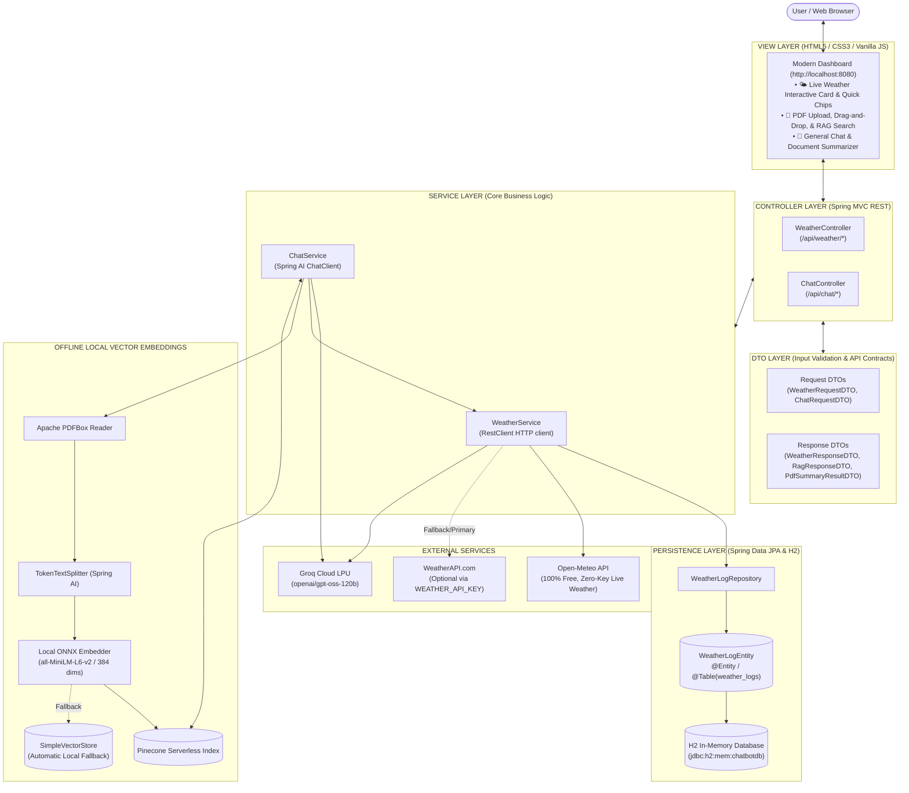

# 🌲 AI Chatbot, PDF Knowledge Assistant & Live Weather Intelligence

A modern, production-ready, full-stack AI platform built with **Spring Boot 4.1.1** and **Spring AI 2.0.1**, architected cleanly according to **MVC (Model - View - Controller - DTO - Entity)** software engineering principles.

The platform provides an end-to-end AI experience:
- **Retrieval-Augmented Generation (RAG)** over PDF documents.
- **100% Free & Offline Vector Embeddings** using Microsoft ONNX Runtime (`all-MiniLM-L6-v2`, 384 dimensions).
- **Groq LPU Ultra-Fast Inference** (OpenAI-compatible client with `openai/gpt-oss-120b`).
- **Live 3rd-Party Weather API Integration** (Open-Meteo & WeatherAPI.com).
- **Relational Persistence** via Spring Data JPA and an in-memory **H2 Database** (`weather_logs` table).
- **Single-Page Interactive Dashboard** with live weather cards, PDF drag-and-drop, and citations.

---

## 🌟 Key Features

| Feature | Description |
| :--- | :--- |
| **🌤️ Live Weather (3rd-Party APIs)** | Real-time global weather fetching using **Open-Meteo** (100% free, zero-config, no key required) and **WeatherAPI.com** fallback/primary. |
| **💾 JPA Entity Persistence (H2)** | Tracks user weather inquiries and AI responses in an in-memory SQL database with an integrated web inspection console at `/h2-console`. |
| **🧠 PDF Document RAG** | Ingests PDF files, performs layout-aware text splitting via Apache PDFBox & `TokenTextSplitter`, stores embeddings in **Pinecone** (or in-memory fallback), and returns cited answers. |
| **⚡ Zero-Cost Local Embeddings** | Generates 384-dimensional dense vectors locally with **Microsoft ONNX Runtime** (`all-MiniLM-L6-v2`). No token fees or OpenAI API costs for embeddings! |
| **📄 Executive PDF Summarization** | Automatically summarizes lengthy documents into structured Markdown: Executive Summary, Key Highlights, Detailed Insights, and Conclusions. |
| **💬 Groq LPU Chat Engine** | High-throughput, low-latency conversational AI with built-in weather tool intelligence. |
| **🎨 Modern Responsive View (UI)** | Single-page HTML5/CSS3/Vanilla JS UI with interactive mode switching (**Live Weather**, **Ask PDF (RAG)**, **General Chat**, **Summarize PDF**), drag & drop file uploads, collapsible sources, and responsive mobile/tablet layout. |

---

## 🏛️ MVC Architecture & Layer Organization

The application strictly separates responsibilities into standard enterprise Spring Boot layers:

```
src/main/java/com/spring/ai_chatbot/
├── AiChatbotApplication.java            # Spring Boot application bootstrap entry point
├── config/                             # Infrastructure beans & servlet mappings
│   ├── VectorStoreConfig.java          # ONNX Embeddings & Pinecone / SimpleVectorStore setup
│   └── H2ConsoleConfig.java            # H2 JakartaWebServlet mapping for /h2-console/*
├── entity/                             # [MODEL / ENTITY] Persistent database domain objects
│   └── WeatherLogEntity.java           # JPA @Entity mapped to 'weather_logs' table in H2
├── repository/                         # [REPOSITORY] Data Access Layer (Spring Data JPA)
│   └── WeatherLogRepository.java       # Custom finder methods & standard CRUD operations
├── dto/                                # [DTO] Data Transfer Objects (Decoupled API contracts)
│   ├── request/
│   │   ├── ChatRequestDTO.java         # Validated user chat input (@NotBlank)
│   │   └── WeatherRequestDTO.java      # Validated city & question payload (@NotBlank)
│   └── response/
│       ├── ChatResponseDTO.java        # Standard LLM response container
│       ├── WeatherResponseDTO.java     # Live meteorological data + AI advice
│       ├── RagResponseDTO.java          # Grounded response with document citations
│       ├── SourceInfoDTO.java          # Source filename, page number, and snippet
│       ├── PdfIndexResultDTO.java      # Upload metadata (page count, chunk count)
│       ├── PdfSummaryResultDTO.java    # Executive markdown summary
│       └── SystemStatusDTO.java        # System health & active vector store info
├── service/                            # [SERVICE] Business logic & external API orchestrators
│   ├── WeatherService.java             # WeatherAPI.com + Open-Meteo REST client & JPA logging
│   └── ChatService.java               # Groq LLM client, RAG vector search, and token chunking
└── controller/                         # [CONTROLLER] REST API HTTP Endpoints
    ├── WeatherController.java          # /api/weather, /api/weather/ask, /api/weather/history
    └── ChatController.java             # /api/chat, /api/chat/rag, /api/chat/upload, /api/chat/summarize

src/main/resources/
├── application.properties               # Environment variable bindings, H2 & logging configs
└── static/
    └── index.html                      # [VIEW] Responsive Single-Page Interface
```

---

## 🏗️ End-to-End System Architecture



---

## 💻 Technology Stack

| Layer | Technology | Version | Description |
| :--- | :--- | :--- | :--- |
| **Framework** | Spring Boot | `4.1.1` | Core microservice framework |
| **AI Orchestration** | Spring AI | `2.0.1` | Prompt management, `ChatClient`, and Vector store interfaces |
| **Database** | H2 Database | `2.4.240` | In-memory relational database for query audit logs |
| **ORM / Persistence** | Spring Data JPA / Hibernate | 6.x | Entity mapping and automated repository queries |
| **Vector DB** | Pinecone | Serverless | Cloud vector database for semantic similarity search |
| **Embedding Model** | Microsoft ONNX Runtime | `1.21.1` | Local `all-MiniLM-L6-v2` (384 dims, 100% offline & free) |
| **LLM Inference** | Groq Cloud LPU | `openai/gpt-oss-120b` | High-token throughput conversational engine |
| **Document Reader** | Apache PDFBox | `3.0.7` | High-fidelity PDF layout and text extraction |
| **Weather Feed** | Open-Meteo & WeatherAPI.com | v1 | Public REST live meteorological feeds |
| **Java Runtime** | Eclipse Adoptium OpenJDK | `17 (LTS)` | Recommended runtime |
| **Frontend** | HTML5 / CSS3 / Vanilla JS | - | Single-page zero-dependency responsive interface |

---

## 📡 REST API Reference

### 1. Weather API Endpoints (`/api/weather`)

#### • Get Real-Time Weather
Fetches live conditions for a specified city and persists the record to the H2 database.
- **Method & URL:** `GET /api/weather?city={cityName}`
- **Sample Request:** `GET /api/weather?city=Tokyo`
- **Sample Response (200 OK):**
  ```json
  {
    "city": "Tokyo",
    "region": "Tokyo",
    "country": "Japan",
    "temperatureC": 18.5,
    "temperatureF": 65.3,
    "conditionText": "Partly cloudy",
    "conditionIcon": "https://cdn.weatherapi.com/weather/64x64/day/116.png",
    "humidity": 58,
    "windKph": 12.6,
    "feelsLikeC": 18.0,
    "uvIndex": 3.0,
    "provider": "Open-Meteo (Live API)",
    "lastUpdated": "2026-10-21 00:15",
    "aiCommentary": null
  }
  ```

#### • Ask AI About Live Weather
Fetches real-time weather and generates personalized AI recommendations via Groq.
- **Method & URL:** `POST /api/weather/ask`
- **Headers:** `Content-Type: application/json`
- **Request Body:**
  ```json
  {
    "city": "London",
    "question": "What should I wear for a walking tour today?"
  }
  ```
- **Sample Response (200 OK):**
  ```json
  {
    "city": "London",
    "country": "United Kingdom",
    "temperatureC": 12.0,
    "temperatureF": 53.6,
    "conditionText": "Light rain",
    "humidity": 82,
    "windKph": 19.5,
    "provider": "Open-Meteo (Live API)",
    "aiCommentary": "Expect damp conditions with light rain and 12°C. A waterproof jacket with a hood, water-resistant walking shoes, and an umbrella are strongly recommended."
  }
  ```

#### • Weather Query History (H2 Database)
Returns the last 15 weather searches persisted in the database.
- **Method & URL:** `GET /api/weather/history`

---

### 2. Chat & PDF Endpoints (`/api/chat`)

#### • General Chat
Direct conversational chat powered by Groq with automatic weather query detection.
- **Method & URL:** `POST /api/chat`
- **Request Body:**
  ```json
  {
    "message": "Explain microservices architecture in 3 simple bullets."
  }
  ```

#### • Upload & Index PDF (RAG Pipeline)
Extracts PDF text, chunks tokens, generates local ONNX embeddings, and indexes them into Pinecone.
- **Method & URL:** `POST /api/chat/upload`
- **Headers:** `Content-Type: multipart/form-data`
- **Form Param:** `file`: `[binary PDF]`
- **Sample Response (200 OK):**
  ```json
  {
    "fileName": "financial_report.pdf",
    "pageCount": 5,
    "chunkCount": 16,
    "message": "Successfully parsed 5 pages and stored 16 vector chunks into Pinecone Vector DB using free offline embeddings."
  }
  ```

#### • Ask Grounded Questions (RAG Search)
Performs cosine similarity search over vector store and generates an answer citing sources and pages.
- **Method & URL:** `POST /api/chat/rag`
- **Request Body:**
  ```json
  {
    "message": "What were the quarterly revenue numbers?"
  }
  ```
- **Sample Response (200 OK):**
  ```json
  {
    "answer": "According to the financial report, Q3 revenue reached $4.2M [Source 1: financial_report.pdf, Page: 2].",
    "sources": [
      {
        "document": "financial_report.pdf",
        "page": "2",
        "snippet": "...Q3 revenue totaled $4.2 million, representing an 18% increase year-over-year..."
      }
    ],
    "contextFound": true
  }
  ```

#### • Direct PDF Summarization
Generates an executive, structured Markdown summary directly from an uploaded document.
- **Method & URL:** `POST /api/chat/summarize`
- **Headers:** `Content-Type: multipart/form-data`
- **Form Param:** `file`: `[binary PDF]`

#### • System Health & Vector Store Status
- **Method & URL:** `GET /api/chat/status`

---

### 3. H2 Database Console
The in-browser H2 SQL inspection console is accessible at:
- **URL:** [http://localhost:8080/h2-console](http://localhost:8080/h2-console)
- **Saved Settings:** `Generic H2 (Embedded)`
- **Driver Class:** `org.h2.Driver`
- **JDBC URL:** `jdbc:h2:mem:chatbotdb`
- **User Name:** `sa`
- **Password:** *(leave empty)*

---

## 🔐 Environment Variables & Security

To maintain security, **no API keys or credentials are hardcoded into version control**. Spring Boot dynamically resolves keys from your environment:

| Variable Name | Required? | Description | Default Fallback |
| :--- | :---: | :--- | :--- |
| `GROQ_API_KEY` | **Yes** | Secret API key for Groq Cloud LLM | *(None &mdash; required for chat)* |
| `WEATHER_API_KEY` | No | WeatherAPI.com secret key | Defaults to **Open-Meteo** (no key needed) |
| `PINECONE_API_KEY` | No | Secret API key for Pinecone | Defaults to in-memory `SimpleVectorStore` |
| `PINECONE_INDEX_NAME`| No | Pinecone Serverless index name | `ai-chatbot` |
| `PINECONE_ENVIRONMENT`| No | Pinecone Cloud region | `gcp-starter` |
| `SERVER_PORT` | No | Embedded web server port | `8080` |

---

## 🚀 Quickstart Guide

### 1. Prerequisites
- **Java 17 JDK** (`java -version`)
- **Apache Maven 3.8+** (`mvn -version`)
- **Groq API Key**: Create a free API key at [console.groq.com/keys](https://console.groq.com/keys)

### 2. Configure Environment in IntelliJ IDEA
1. Open the project in IntelliJ IDEA.
2. In the top-right toolbar, click the dropdown next to the Green Play button ➔ **Edit Configurations...**
3. Select **AiChatbotApplication**.
4. In **Environment variables**, paste:
   ```text
   GROQ_API_KEY=gsk_your_groq_api_key_here
   ```
   *(Optionally add `WEATHER_API_KEY=your_key` or `PINECONE_API_KEY=your_key`)*.
5. Click **Apply** and **OK**.

### 3. Run the Application
Run via IntelliJ **Run ▶️** button, or execute from your terminal:

```powershell
# Windows PowerShell
$env:GROQ_API_KEY="gsk_your_groq_api_key_here"
mvn clean package -DskipTests
mvn spring-boot:run
```

```bash
# macOS / Linux
export GROQ_API_KEY="gsk_your_groq_api_key_here"
mvn clean package -DskipTests
mvn spring-boot:run
```

### 4. Open the Web Application
Open your browser and navigate to:
- **Interactive UI Dashboard:** [http://localhost:8080](http://localhost:8080)
- **H2 Database Console:** [http://localhost:8080/h2-console](http://localhost:8080/h2-console)

---

## 🛠️ Troubleshooting & FAQ

### 1. `Whitelabel Error 404: No static resource h2-console`
- **Cause:** Spring Boot 4 requires explicit servlet registration for H2's `JakartaWebServlet`.
- **Solution:** Handled automatically via [`H2ConsoleConfig.java`](file:///D:/ChatBot/ai-chatbot/src/main/java/com/spring/ai_chatbot/config/H2ConsoleConfig.java). Make sure to access `http://localhost:8080/h2-console` after restarting the application.

### 2. `Groq API Key was NOT detected`
- Verify that your variable name in IntelliJ is spelled **`GROQ_API_KEY`**.
- Remember to **Stop ⏹️** and **Restart ▶️** the app after adding environment variables in IntelliJ.

### 3. `DLL initialization routine failed` (Windows ONNX runtime)
- Ensure you run on **Java 17 LTS**.
- Install the [Microsoft Visual C++ Redistributable (x64)](https://aka.ms/vs/17/release/vc_redist.x64.exe) if running on Windows.

---

## 📜 License
This project is open-source and licensed under the [Apache License 2.0](LICENSE).
