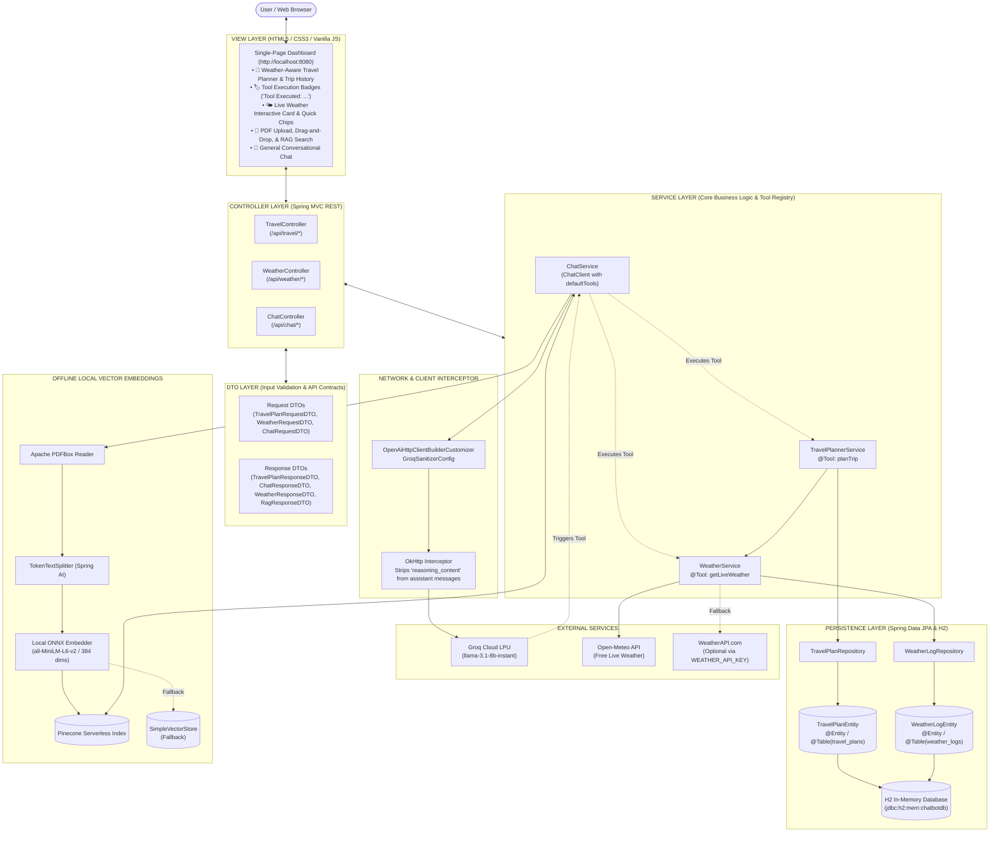
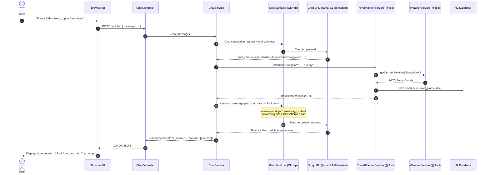

# 🌲 AI Chatbot, PDF Knowledge Assistant, Live Weather & Autonomous Travel Planner

[](https://spring.io/projects/spring-boot)
[](https://spring.io/projects/spring-ai)
[](https://adoptium.net)
[](https://groq.com)
[](https://www.h2database.com)
[-blueviolet.svg)](https://onnxruntime.ai)

A modern, production-ready, full-stack AI platform built with **Spring Boot 4.1.1** and **Spring AI 2.0.1**, architected cleanly according to **MVC (Model - View - Controller - DTO - Entity)** software engineering principles.

The platform provides an end-to-end AI experience:
- **Autonomous Tool Calling (Function Calling)**: Powered by Groq's high-speed **`llama-3.1-8b-instant`** model with `@Tool` registered agents (`planTrip`, `getLiveWeather`).
- **Weather-Aware Travel Planner**: Generates day-by-day itineraries tailored to duration, budget, and travel style while consulting live destination weather in real-time.
- **Visual Tool Calling Badges**: Displays purple badges in the chat UI whenever the LLM executes underlying tools/functions.
- **Retrieval-Augmented Generation (RAG)** over PDF documents.
- **100% Free & Offline Vector Embeddings** using Microsoft ONNX Runtime (`all-MiniLM-L6-v2`, 384 dimensions).
- **Groq LPU Ultra-Fast Inference** (OpenAI-compatible client with `llama-3.1-8b-instant`).
- **Groq Payload Sanitizer**: Custom OkHttp interceptor that automatically strips unsupported `reasoning_content` fields during multi-turn tool calling.
- **Live 3rd-Party Weather API Integration** (Open-Meteo & WeatherAPI.com).
- **Relational Persistence** via Spring Data JPA and an in-memory **H2 Database** (`travel_plans` and `weather_logs` tables).
- **Single-Page Interactive Dashboard** with mode switcher, live travel cards, weather widgets, PDF drag-and-drop, and citations.

---

## 🌟 Key Features

| Feature | Description |
| :--- | :--- |
| **🧳 Autonomous Travel Planner** | Weather-aware trip planner tool (`planTrip`) that generates detailed itineraries factoring in days, budget category, interests, and real-time destination weather. |
| **🛠️ Spring AI Tool Calling** | Native tool/function calling registered via `@Tool` annotations, allowing the LLM to autonomously trigger internal services when answering conversational prompts. |
| **🏷️ Visual Tool Calling Badges** | The UI highlights executed tools with custom chips (e.g., `Tool Executed: planTrip`, `Tool Executed: getLiveWeather`) alongside the generated answer. |
| **🛡️ Groq Payload Sanitizer** | Custom OkHttp interceptor that prevents Groq `400 Bad Request` schema errors by sanitizing `reasoning_content` in multi-turn assistant messages. |
| **🌤️ Live Weather (3rd-Party APIs)** | Real-time global weather fetching using **Open-Meteo** (100% free, zero-config, no key required) and **WeatherAPI.com** fallback/primary. |
| **💾 JPA Entity Persistence (H2)** | Tracks user weather logs and generated travel itineraries in an in-memory SQL database with an integrated web inspection console at `/h2-console`. |
| **🧠 PDF Document RAG** | Ingests PDF files, performs layout-aware text splitting via Apache PDFBox & `TokenTextSplitter`, stores embeddings in **Pinecone** (or in-memory fallback), and returns cited answers. |
| **⚡ Zero-Cost Local Embeddings** | Generates 384-dimensional dense vectors locally with **Microsoft ONNX Runtime** (`all-MiniLM-L6-v2`). No token fees or OpenAI API costs for embeddings! |
| **📄 Executive PDF Summarization** | Automatically summarizes lengthy documents into structured Markdown: Executive Summary, Key Highlights, Detailed Insights, and Conclusions. |
| **💬 Groq LPU Chat Engine** | High-throughput, low-latency conversational AI powered by **`llama-3.1-8b-instant`** with tool calling and fallback intelligence. |
| **🎨 Modern Responsive View (UI)** | Single-page HTML5/CSS3/Vanilla JS UI with interactive mode switching (**Travel Planner**, **Live Weather**, **Ask PDF (RAG)**, **General Chat**, **Summarize PDF**), quick chips, and responsive layout. |

---

## 🏛️ MVC Architecture & Layer Organization

The application strictly separates responsibilities into standard enterprise Spring Boot layers:

```
src/main/java/com/spring/ai_chatbot/
├── AiChatbotApplication.java            # Spring Boot application bootstrap entry point
│
├── config/                             # [CONFIGURATION LAYER]
│   ├── GroqSanitizerConfig.java        # OkHttp interceptor stripping unsupported reasoning_content for Groq
│   ├── H2ConsoleConfig.java            # JakartaWebServlet registration for /h2-console/*
│   └── VectorStoreConfig.java          # ONNX Embeddings & Pinecone / SimpleVectorStore setup
│
├── entity/                             # [MODEL / PERSISTENT ENTITY LAYER]
│   ├── TravelPlanEntity.java           # JPA @Entity mapped to 'travel_plans' table in H2
│   └── WeatherLogEntity.java           # JPA @Entity mapped to 'weather_logs' table in H2
│
├── repository/                         # [REPOSITORY / DATA ACCESS LAYER]
│   ├── TravelPlanRepository.java       # Spring Data JPA CRUD & finder methods for travel plans
│   └── WeatherLogRepository.java       # Spring Data JPA CRUD & finder methods for weather logs
│
├── dto/                                # [DTO / CONTRACT LAYER]
│   ├── request/
│   │   ├── ChatRequestDTO.java         # Validated user chat input (@NotBlank)
│   │   ├── TravelPlanRequestDTO.java   # Validated travel requirements payload
│   │   └── WeatherRequestDTO.java      # Validated city & question payload (@NotBlank)
│   └── response/
│       ├── ChatResponseDTO.java        # LLM response + tool calling metadata (List<ToolExecutionDTO>)
│       ├── PdfIndexResultDTO.java      # Upload metadata (page count, chunk count)
│       ├── PdfSummaryResultDTO.java    # Executive markdown summary
│       ├── RagResponseDTO.java          # Grounded response with document citations
│       ├── SourceInfoDTO.java          # Source filename, page number, and snippet
│       ├── SystemStatusDTO.java        # System health & active vector store info
│       ├── TravelPlanResponseDTO.java  # Structured itinerary with weather summary & daily plans
│       └── WeatherResponseDTO.java     # Live meteorological data + AI advice
│
├── service/                            # [SERVICE / BUSINESS LOGIC & TOOL LAYER]
│   ├── ChatService.java               # Groq LLM client, Spring AI tools, RAG vector search & fallback
│   ├── TravelPlannerService.java       # Weather-aware trip planner + @Tool("planTrip") + JPA logging
│   └── WeatherService.java             # Weather API client + @Tool("getLiveWeather") + JPA logging
│
└── controller/                         # [CONTROLLER / REST API ENDPOINT LAYER]
    ├── ChatController.java              # /api/chat, /api/chat/rag, /api/chat/upload, /api/chat/summarize
    ├── TravelController.java            # /api/travel/plan, /api/travel/history
    └── WeatherController.java           # /api/weather, /api/weather/ask, /api/weather/history

src/main/resources/
├── application.properties               # Groq model (llama-3.1-8b-instant), H2 & logging configs
└── static/
    └── index.html                      # [VIEW LAYER] Single-Page Dashboard with Tool Badges
```

---

## 🏗️ End-to-End System Architecture



---

## 🛠️ Spring AI Tool Calling & Autonomous Execution

### 1. Tool Declaration & Registration
Methods in services are decorated with `@Tool` and `@ToolParam` annotations:

```java
@Service
public class TravelPlannerService {
    @Tool(name = "planTrip", description = "Generate a personalized, weather-aware travel itinerary for a destination")
    public TravelPlanResponseDTO planTrip(
            @ToolParam(description = "Destination city name") String destination,
            @ToolParam(description = "Number of days for the trip") int durationDays,
            @ToolParam(description = "Budget level: budget, moderate, or luxury") String budget,
            @ToolParam(description = "Traveler interests") String interests,
            @ToolParam(description = "Additional traveler notes or preferences") String travelStyle) { ... }
}
```

In [`ChatService.java`](file:///D:/ChatBot/ai-chatbot/src/main/java/com/spring/ai_chatbot/service/ChatService.java), these tools are registered with `ChatClient`:

```java
this.chatClient = chatClientBuilder
        .defaultTools(weatherService, travelPlannerService)
        .build();
```

### 2. Multi-Turn Tool Resolution Lifecycle



### 3. The Groq Payload Sanitizer Interceptor
When Spring AI executes a tool call, its internal serializer attaches `reasoning_content` to the `role: "assistant"` message. Groq's OpenAPI schema strictly rejects any payload containing `reasoning_content` with a `400 Bad Request`.

[`GroqSanitizerConfig.java`](file:///D:/ChatBot/ai-chatbot/src/main/java/com/spring/ai_chatbot/config/GroqSanitizerConfig.java) resolves this transparently:
- Registers an `OpenAiHttpClientBuilderCustomizer` bean.
- Intercepts outgoing requests targeting `api.groq.com`.
- Inspects the JSON body and surgically strips `reasoning_content` and `reasoning` from the `messages` array.
- Ensures all multi-turn function calls complete with 100% success.

---

## 🧳 Weather-Aware Autonomous Travel Planner

The Travel Planner bridges real-time external meteorology with conversational intelligence:
1. **Live Weather Lookup**: When planning a trip, `TravelPlannerService` calls `WeatherService.getCurrentWeather(destination)` (utilizing Open-Meteo or WeatherAPI.com).
2. **Contextual Itinerary Generation**: The destination temperature, conditions, and humidity are provided as context to Groq, generating realistic morning, afternoon, and evening recommendations suited for that climate.
3. **Smart Packing Advice**: Automatic packing suggestions (e.g., umbrella for rain, breathable layers for heat, thermal jackets for cold).
4. **Relational JPA Logging**: Persists every generated plan into the `travel_plans` table for historical inspection.

---

## 🧠 Offline Local Embeddings & PDF RAG

- **Zero Cost & Privacy Preserving**: Embeddings are calculated locally using **Microsoft ONNX Runtime** (`all-MiniLM-L6-v2`, 384 dimensions). No tokens are consumed and no PDF content is sent to third-party embedding APIs.
- **Smart Token Chunking**: Uses `TokenTextSplitter` (Spring AI) with Apache PDFBox layout awareness.
- **Vector DB Options**:
  - **Pinecone**: Production serverless vector index.
  - **SimpleVectorStore**: Automatic local in-memory fallback if Pinecone keys are omitted.
- **Grounded Citations**: The `/api/chat/rag` endpoint returns answers accompanied by the exact document name, page number, and text snippet.

---

## 💻 Technology Stack

| Layer | Technology | Version | Description |
| :--- | :--- | :--- | :--- |
| **Framework** | Spring Boot | `4.1.1` | Core microservice framework |
| **AI Orchestration** | Spring AI | `2.0.1` | Prompt management, `ChatClient`, Vector store, `@Tool` execution |
| **LLM Inference** | Groq Cloud LPU | `llama-3.1-8b-instant` | Ultra-fast token generation with native tool/function calling support |
| **Tool Calling API** | Spring AI Tools | `2.0.1` | Method-level tool registration (`@Tool`, `@ToolParam`) |
| **Database** | H2 Database | `2.4.240` | In-memory relational database for query audit logs and travel plans |
| **ORM / Persistence** | Spring Data JPA / Hibernate | 6.x | Entity mapping and automated repository queries |
| **Vector DB** | Pinecone | Serverless | Cloud vector database for semantic similarity search |
| **Embedding Model** | Microsoft ONNX Runtime | `1.21.1` | Local `all-MiniLM-L6-v2` (384 dims, 100% offline & free) |
| **Document Reader** | Apache PDFBox | `3.0.7` | High-fidelity PDF layout and text extraction |
| **Weather Feed** | Open-Meteo & WeatherAPI.com | v1 | Public REST live meteorological feeds |
| **Java Runtime** | Eclipse Adoptium OpenJDK | `17 (LTS)` | Recommended runtime |
| **Frontend** | HTML5 / CSS3 / Vanilla JS | - | Single-page zero-dependency responsive interface with tool calling badges |

---

## 📡 REST API Reference

### 1. Travel Planner Endpoints (`/api/travel`)

#### • Generate Itinerary
- **Method & URL:** `POST /api/travel/plan`
- **Headers:** `Content-Type: application/json`
- **Request Body:**
  ```json
  {
    "destination": "Bangalore, India",
    "durationDays": 3,
    "budget": "luxury",
    "interests": "food & culinary"
  }
  ```
- **Sample Response (200 OK):**
  ```json
  {
    "destination": "Bangalore, India",
    "durationDays": 3,
    "budget": "luxury",
    "interests": "food & culinary",
    "weatherSummary": "Bangalore, India: 24.0°C, Partly cloudy, Humidity: 62%",
    "itineraryMarkdown": "## 3-Day Luxury Culinary Tour of Bangalore\n\n### Day 1: Heritage & Fine Dining\n- **Morning:** Breakfast at Vidyarthi Bhavan...",
    "days": [
      {
        "dayNumber": 1,
        "title": "Heritage & Fine Dining",
        "activities": ["Breakfast at Vidyarthi Bhavan", "Private brewery tour in Indiranagar", "Chef tasting menu at Karavalli"]
      }
    ],
    "packingRecommendations": "Mild and pleasant weather (24°C). Smart casual evening wear and comfortable walking shoes are recommended.",
    "createdAt": "2026-10-21T21:40:00"
  }
  ```

#### • Trip History (H2 Database)
- **Method & URL:** `GET /api/travel/history`

---

### 2. Chat & Tool Calling Endpoints (`/api/chat`)

#### • General Chat (Autonomous Spring AI Tool Calling)
- **Method & URL:** `POST /api/chat`
- **Request Body:**
  ```json
  {
    "message": "Plan a 3-day food & culinary trip to bangalore (Luxury budget)"
  }
  ```
- **Sample Response (200 OK):**
  ```json
  {
    "response": "Here is your tailored 3-day luxury culinary itinerary for Bangalore, taking into account the current pleasant weather of 24°C...",
    "mode": "chat",
    "toolCalls": [
      {
        "toolName": "planTrip",
        "arguments": "{\"destination\":\"Bangalore\",\"durationDays\":3,\"budget\":\"luxury\",\"interests\":\"food & culinary\"}",
        "status": "EXECUTED"
      }
    ]
  }
  ```

#### • Upload & Index PDF (RAG Pipeline)
- **Method & URL:** `POST /api/chat/upload`
- **Headers:** `Content-Type: multipart/form-data`
- **Form Param:** `file`: `[binary PDF]`

#### • Ask Grounded Questions (RAG Search)
- **Method & URL:** `POST /api/chat/rag`
- **Request Body:**
  ```json
  {
    "message": "What were the key financial results for Q3?"
  }
  ```

#### • Direct PDF Summarization
- **Method & URL:** `POST /api/chat/summarize`
- **Headers:** `Content-Type: multipart/form-data`
- **Form Param:** `file`: `[binary PDF]`

#### • System Health & Vector Store Status
- **Method & URL:** `GET /api/chat/status`

---

### 3. Weather API Endpoints (`/api/weather`)

#### • Get Real-Time Weather
- **Method & URL:** `GET /api/weather?city={cityName}`

#### • Ask AI About Live Weather
- **Method & URL:** `POST /api/weather/ask`
- **Request Body:**
  ```json
  {
    "city": "Tokyo",
    "question": "What should I wear today?"
  }
  ```

#### • Weather Query History (H2 Database)
- **Method & URL:** `GET /api/weather/history`

---

### 4. H2 Database Console
The in-browser H2 SQL inspection console is accessible at:
- **URL:** [http://localhost:8080/h2-console](http://localhost:8080/h2-console)
- **Saved Settings:** `Generic H2 (Embedded)`
- **Driver Class:** `org.h2.Driver`
- **JDBC URL:** `jdbc:h2:mem:chatbotdb`
- **User Name:** `sa`
- **Password:** *(leave empty)*

**Tables available:**
- `TRAVEL_PLANS`: Stores generated destination itineraries, duration, budget, weather summaries, packing advice, and timestamps.
- `WEATHER_LOGS`: Stores city weather inquiries, temperatures, conditions, providers, and AI advice.

---

## 🔐 Environment Variables & Security

To maintain security, **no API keys or credentials are hardcoded into version control**. Spring Boot dynamically resolves keys from your environment:

| Variable Name | Required? | Description | Default Fallback |
| :--- | :---: | :--- | :--- |
| `GROQ_API_KEY` | **Yes** | Secret API key for Groq Cloud LLM | *(None — required for chat & travel)* |
| `GROQ_MODEL` | No | Groq Chat Model | `llama-3.1-8b-instant` |
| `WEATHER_API_KEY` | No | WeatherAPI.com secret key | Defaults to **Open-Meteo** (no key needed) |
| `PINECONE_API_KEY` | No | Secret API key for Pinecone | Defaults to in-memory `SimpleVectorStore` |
| `PINECONE_INDEX_NAME`| No | Pinecone Serverless index name | `ai-chatbot` |
| `PINECONE_ENVIRONMENT`| No | Pinecone Cloud region | `gcp-starter` |
| `PORT` / `SERVER_PORT` | No | Embedded web server port | `8080` |

---

## 🚀 Quickstart Guide

### 1. Prerequisites
- **Java 17 JDK** (`java -version`)
- **Apache Maven 3.8+** (`mvn -version`)
- **Groq API Key**: Create a free API key at [console.groq.com/keys](https://console.groq.com/keys)

### 2. Configure Environment in IntelliJ IDEA
1. Open the project in IntelliJ IDEA.
2. In the top-right toolbar, click the dropdown next to the Green Play button ➔ **Edit Configurations...**
3. Select **AiChatbotApplication**.
4. In **Environment variables**, paste:
   ```text
   GROQ_API_KEY=gsk_your_groq_api_key_here
   ```
   *(Optionally add `WEATHER_API_KEY=your_key` or `PINECONE_API_KEY=your_key`)*.
5. Click **Apply** and **OK**.

### 3. Run the Application
Run via IntelliJ **Run ▶️** button, or execute from your terminal:

```powershell
# Windows PowerShell
$env:GROQ_API_KEY="gsk_your_groq_api_key_here"
mvn clean package -DskipTests
mvn spring-boot:run
```

```bash
# macOS / Linux
export GROQ_API_KEY="gsk_your_groq_api_key_here"
mvn clean package -DskipTests
mvn spring-boot:run
```

### 4. Open the Web Application
Open your browser and navigate to:
- **Interactive UI Dashboard:** [http://localhost:8080](http://localhost:8080)
- **H2 Database Console:** [http://localhost:8080/h2-console](http://localhost:8080/h2-console)

---

## 🛠️ Troubleshooting & FAQ

### 1. `Error: 404: The model llama-3.3-70b-versatile does not exist or you do not have access to it`
- **Cause:** Large 70B models often require enterprise entitlements or have restricted capacity on standard Groq free tiers.
- **Solution:** We configured the default model to **`llama-3.1-8b-instant`**, which is available to all accounts, has native tool calling, and generates over 700+ tokens/sec.

### 2. `Error: 400: 'messages.X' : property 'reasoning_content' is unsupported`
- **Cause:** Spring AI's internal OpenAI serializer includes `reasoning_content` in assistant messages during multi-turn tool calling, which Groq's OpenAPI validator strictly rejects.
- **Solution:** Automatically handled by [`GroqSanitizerConfig.java`](file:///D:/ChatBot/ai-chatbot/src/main/java/com/spring/ai_chatbot/config/GroqSanitizerConfig.java), which strips unsupported `reasoning_content` fields before requests are sent to Groq.

### 3. `Whitelabel Error 404: No static resource h2-console`
- Explicitly registered via [`H2ConsoleConfig.java`](file:///D:/ChatBot/ai-chatbot/src/main/java/com/spring/ai_chatbot/config/H2ConsoleConfig.java). Make sure to access `http://localhost:8080/h2-console` after starting the application.

### 4. `Groq API Key was NOT detected`
- Verify that your variable name in IntelliJ is spelled **`GROQ_API_KEY`**.
- Remember to **Stop ⏹️** and **Restart ▶️** the app after adding environment variables in IntelliJ.

---

## 📜 License
This project is open-source and licensed under the [Apache License 2.0](LICENSE).
