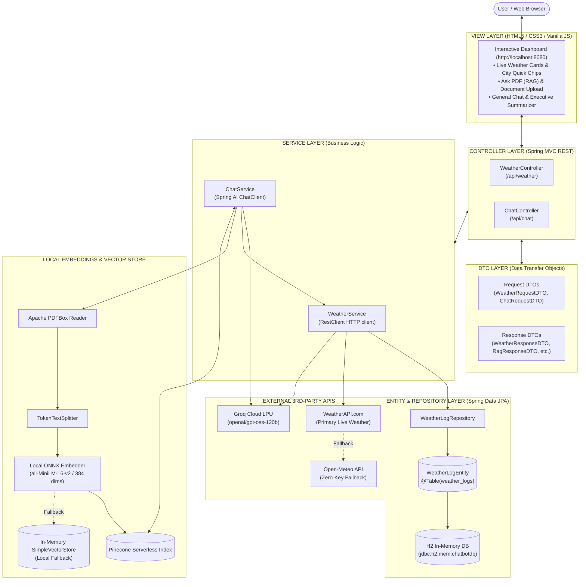

# 🌲 AI Chatbot, PDF Knowledge Assistant & Live Weather Intelligence

A production-ready, full-stack AI assistant built with **Spring Boot 4.1.1** and **Spring AI 2.0.1**, architected strictly according to enterprise **MVC (Model - View - Controller - DTO - Entity)** design principles.

The application combines **Retrieval-Augmented Generation (RAG)** over PDF documents, **100% free offline local ONNX vector embeddings**, **Groq LPU ultra-fast inference**, **real-time 3rd-party Weather API integration** (WeatherAPI.com with automated Open-Meteo fallback), and **Spring Data JPA persistence with an in-memory H2 database**.

---

## 🌟 Key Capabilities

- **🌤️ Live 3rd-Party Weather API Integration:**
  - Real-time weather lookup for any city worldwide using **WeatherAPI.com** with automated zero-config fallback to **Open-Meteo**.
  - Fetches temperature (°C and °F), meteorological conditions, icons, humidity, wind speed, and feels-like temperatures.
  - Conversational AI weather analysis (e.g., *"What should I wear in Tokyo today?"*).
- **💾 JPA Entity Persistence & H2 In-Memory Database:**
  - Every weather query and AI interaction is stored in an H2 relational table (`weather_logs`) using standard JPA `@Entity` mapping.
  - Built-in in-browser database inspection console available at `/h2-console`.
- **🧠 Retrieval-Augmented Generation (RAG):**
  - Semantic vector similarity search over user-uploaded PDF documents stored in **Pinecone Serverless**.
  - Automatic fallback to an in-memory vector store when Pinecone credentials are not configured.
  - Contextual citations and references displaying exact source document names and page numbers.
- **⚡ 100% Free & Offline Local Embeddings:**
  - Powered locally by **Microsoft ONNX Runtime** and `all-MiniLM-L6-v2` (384 dimensions).
  - Runs directly on CPU/GPU — **zero OpenAI API cost** and no data leaks for embedding generation.
- **📄 High-Speed PDF Ingestion & Summarization:**
  - Apache PDFBox document parsing with token chunking via Spring AI `TokenTextSplitter`.
  - Executive structured Markdown summaries generated directly from raw PDF uploads.
- **💬 Ultra-Fast Conversational LLM via Groq:**
  - OpenAI-compatible chat client leveraging Groq LPU inference for high-token throughput with low latency.
  - Live weather tool intelligence embedded directly into general chat queries.
- **🎨 Modern Interactive Web UI (View Layer):**
  - Single-page application served directly from Spring Boot (`/`).
  - Interactive mode switching: **Live Weather**, **Ask PDF (RAG)**, **General Chat**, and **Summarize PDF**.

---

## 🏛️ MVC Architecture & Design Pattern

The codebase adheres strictly to standard Spring Boot MVC layer separation:

```
com.spring.ai_chatbot
├── AiChatbotApplication.java            # Main Spring Boot bootstrap entry point
├── config/                             # Infrastructure & Bean configurations
│   └── VectorStoreConfig.java          # ONNX Embeddings & Pinecone / SimpleVectorStore setup
├── entity/                             # [MODEL / ENTITY] Persistent JPA database entities
│   └── WeatherLogEntity.java           # @Entity mapped to 'weather_logs' in H2 database
├── repository/                         # [REPOSITORY] Spring Data JPA data access interfaces
│   └── WeatherLogRepository.java       # JpaRepository queries for recent lookups
├── dto/                                # [DTO] Data Transfer Objects (Request / Response)
│   ├── request/
│   │   ├── ChatRequestDTO.java         # Validated chat prompt payload (@NotBlank)
│   │   └── WeatherRequestDTO.java      # Validated weather query payload (@NotBlank)
│   └── response/
│       ├── ChatResponseDTO.java        # Standard LLM response
│       ├── WeatherResponseDTO.java     # Live meteorological data + AI advice
│       ├── RagResponseDTO.java          # Cited RAG response with source references
│       ├── SourceInfoDTO.java          # Document citation metadata (page & snippet)
│       ├── PdfIndexResultDTO.java      # Ingestion result with page/chunk counts
│       ├── PdfSummaryResultDTO.java    # Structured document executive summary
│       └── SystemStatusDTO.java        # Live engine & vector store health status
├── service/                            # [SERVICE] Business logic & external service clients
│   ├── WeatherService.java             # WeatherAPI.com + Open-Meteo REST client & H2 logger
│   └── ChatService.java               # Groq LLM orchestration, RAG search & PDF parsing
├── controller/                         # [CONTROLLER] REST API endpoints & request mapping
│   ├── WeatherController.java          # /api/weather/* endpoints
│   └── ChatController.java             # /api/chat/* endpoints
└── view/ (src/main/resources/static/)  # [VIEW] Client presentation layer
    └── index.html                      # Single-page responsive interactive web app
```

---

## 🏗️ End-to-End System Architecture



---

## 📋 Technology Stack

| Component | Technology | Version | Description |
| :--- | :--- | :--- | :--- |
| **Framework** | Spring Boot | `4.1.1` | Core Java microservice framework |
| **AI Orchestration** | Spring AI | `2.0.1` | ChatClient, Prompt templates, and Vector store |
| **Relational Database** | H2 Database | In-Memory | Embedded fast SQL database for weather & chat logs |
| **Persistence (ORM)** | Spring Data JPA / Hibernate | 6.x | Entity mapping and repository management |
| **Vector Database** | Pinecone | Serverless | Cloud-native vector similarity search |
| **Embedding Engine** | Microsoft ONNX Runtime | `all-MiniLM-L6-v2` | 384-dimension free offline local embeddings |
| **LLM Inference** | Groq Cloud LPU | `openai/gpt-oss-120b` | High-speed conversational reasoning |
| **3rd-Party Weather API** | WeatherAPI.com & Open-Meteo | v1 | Live global weather data feeds |
| **Document Parser** | Apache PDFBox | `3.0.7` | High-fidelity PDF layout and text extraction |
| **HTTP Client** | Spring Framework `RestClient` | 6.x | Synchronous HTTP client with connection pooling |
| **Runtime** | Java JDK | `17` | Recommended LTS JDK |

---

## 📡 REST API Reference

### 1. Live Weather API Endpoints

#### • Get Current Weather for a City
Fetches real-time weather, persists the query to the H2 database, and returns structured data.
- **Endpoint:** `GET /api/weather?city={city}`
- **Example:** `GET /api/weather?city=Tokyo`
- **Sample Response:**
  ```json
  {
    "city": "Tokyo",
    "region": "Tokyo",
    "country": "Japan",
    "temperatureC": 18.5,
    "temperatureF": 65.3,
    "conditionText": "Partly cloudy",
    "conditionIcon": "https://cdn.weatherapi.com/weather/64x64/day/116.png",
    "humidity": 58,
    "windKph": 12.6,
    "feelsLikeC": 18.0,
    "uvIndex": 3.0,
    "provider": "WeatherAPI.com",
    "lastUpdated": "2026-10-19 16:30",
    "aiCommentary": null
  }
  ```

#### • Ask AI About Live Weather
Queries live weather and generates Groq LLM commentary tailored to the user's specific scenario.
- **Endpoint:** `POST /api/weather/ask`
- **Headers:** `Content-Type: application/json`
- **Request Body:**
  ```json
  {
    "city": "London",
    "question": "Should I carry an umbrella and a heavy coat today?"
  }
  ```
- **Sample Response:**
  ```json
  {
    "city": "London",
    "country": "United Kingdom",
    "temperatureC": 12.0,
    "temperatureF": 53.6,
    "conditionText": "Light rain",
    "humidity": 85,
    "windKph": 20.5,
    "provider": "WeatherAPI.com",
    "aiCommentary": "Yes, definitely bring an umbrella! Current conditions show light rain with 85% humidity. While a heavy winter coat isn't necessary at 12°C, a waterproof jacket or trench coat is strongly recommended due to 20 km/h winds."
  }
  ```

#### • Get Weather Query History (H2 Database)
Returns the most recent weather queries persisted in the `WeatherLogEntity` table.
- **Endpoint:** `GET /api/weather/history`
- **Sample Response:**
  ```json
  [
    {
      "id": 1,
      "city": "Tokyo",
      "country": "Japan",
      "temperatureC": 18.5,
      "conditionText": "Partly cloudy",
      "provider": "WeatherAPI.com",
      "queryTimestamp": "2026-10-19T17:28:40"
    }
  ]
  ```

#### • H2 In-Memory Database Web Console
- **URL:** `http://localhost:8080/h2-console`
- **JDBC URL:** `jdbc:h2:mem:chatbotdb`
- **User Name:** `sa`
- **Password:** *(leave blank)*

---

### 2. Chat & PDF Document Endpoints

#### • General Chat (with Live Weather Tool Detection)
- **Endpoint:** `POST /api/chat`
- **Request Body:**
  ```json
  {
    "message": "What is the weather in Paris right now?"
  }
  ```
- **Response:**
  ```json
  {
    "response": "According to live weather data from Paris, France, it is currently 16.0°C (60.8°F) with clear skies, 52% humidity, and a light breeze of 8.0 km/h."
  }
  ```

#### • Upload & Index PDF into Vector Store
- **Endpoint:** `POST /api/chat/upload`
- **Headers:** `Content-Type: multipart/form-data`
- **Form Data:** `file`: `[binary PDF]`
- **Response:**
  ```json
  {
    "fileName": "report.pdf",
    "pageCount": 4,
    "chunkCount": 12,
    "message": "Successfully parsed 4 pages and stored 12 vector chunks into Pinecone Vector DB using free offline embeddings."
  }
  ```

#### • Ask Grounded Questions (RAG Search)
- **Endpoint:** `POST /api/chat/rag`
- **Request Body:**
  ```json
  {
    "message": "What were the total expenses mentioned in the report?"
  }
  ```
- **Response:**
  ```json
  {
    "answer": "Total operating expenses for Q3 reached $1.8M [Source 1: report.pdf, Page: 3].",
    "sources": [
      {
        "document": "report.pdf",
        "page": "3",
        "snippet": "...operating expenses for the third quarter totaled $1.8 million..."
      }
    ],
    "contextFound": true
  }
  ```

#### • Direct PDF Summarization
- **Endpoint:** `POST /api/chat/summarize`
- **Headers:** `Content-Type: multipart/form-data`
- **Form Data:** `file`: `[binary PDF]`

#### • Engine & Vector Store Health Check
- **Endpoint:** `GET /api/chat/status`

---

## ⚙️ Environment Variables Reference

API keys and secrets are loaded securely from environment variables, preventing secret leakage in version control:

| Variable Name | Description | Default / Fallback |
| :--- | :--- | :--- |
| `GROQ_API_KEY` | Secret API key for Groq Cloud inference | *(Required for chat / LLM)* |
| `WEATHER_API_KEY` | Secret API key for WeatherAPI.com | *(Optional; automatically falls back to Open-Meteo)* |
| `PINECONE_API_KEY` | Secret API key for Pinecone vector store | *(Optional; falls back to in-memory store)* |
| `PINECONE_INDEX_NAME` | Pinecone Serverless index name | `ai-chatbot` |
| `PINECONE_ENVIRONMENT` | Pinecone cloud region | `gcp-starter` |
| `SERVER_PORT` | HTTP port on which the web server listens | `8080` |

---

## 🚀 Getting Started & Local Setup

### 1. Prerequisites
- **Java JDK 17** (e.g. Eclipse Adoptium Temurin 17 or OpenJDK 17).
- **Apache Maven 3.8+**.
- **Free Groq API Key**: Obtain from [console.groq.com/keys](https://console.groq.com/keys).
- **Free WeatherAPI.com Key (Optional)**: Obtain from [weatherapi.com](https://www.weatherapi.com/).

### 2. Configure Environment Variables in IntelliJ IDEA
1. Open IntelliJ IDEA and load the project.
2. In the top-right toolbar, click the Run Configuration dropdown next to the Green Run button ➔ **Edit Configurations...**
3. Select **AiChatbotApplication**.
4. In the **Environment variables** field, enter:
   ```text
   GROQ_API_KEY=gsk_your_groq_key_here;WEATHER_API_KEY=your_weatherapi_key_here
   ```
5. Click **Apply** and **OK**.

### 3. Build & Run from Terminal
Alternatively, set the variables in PowerShell / Bash and launch:

```powershell
# Windows PowerShell
$env:GROQ_API_KEY="gsk_your_groq_key"
$env:WEATHER_API_KEY="your_weather_key"

mvn clean package -DskipTests
mvn spring-boot:run
```

```bash
# macOS / Linux
export GROQ_API_KEY="gsk_your_groq_key"
export WEATHER_API_KEY="your_weather_key"

mvn clean package -DskipTests
mvn spring-boot:run
```

### 4. Access the Application
Open your browser and navigate to:
- **Interactive Web Dashboard:** [http://localhost:8080](http://localhost:8080)
- **H2 Database Console:** [http://localhost:8080/h2-console](http://localhost:8080/h2-console)

---

## 🛡️ Security Best Practices

- `src/main/resources/application.properties` does **NOT** contain hardcoded secrets. It resolves properties dynamically from `${GROQ_API_KEY:}` and `${WEATHER_API_KEY:}`.
- Git commits will never expose your API keys.
- H2 database runs safely in memory and does not write unencrypted sensitive tokens to disk.

---

## 📄 License
This project is licensed under the Apache 2.0 License.
