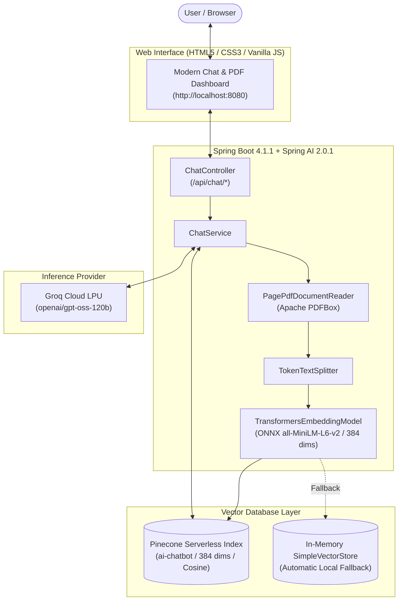

# 🌲 AI Chatbot & PDF Knowledge Assistant

A full-stack, enterprise-grade AI chatbot and document intelligence assistant built with **Spring Boot 4 / Spring AI 2.0.1**, **Pinecone Vector Database**, **Groq LPU Inference**, and **Free Offline Local ONNX Embeddings**.

The system enables users to upload PDF documents, extract and chunk text content, generate dense vector embeddings locally without third-party embedding costs, store them in Pinecone for Retrieval-Augmented Generation (RAG), generate structured executive document summaries, or converse directly with state-of-the-art LLMs via Groq.

---

## 🌟 Key Features

- **🧠 Retrieval-Augmented Generation (RAG):**
  - Semantic similarity search over documents stored in Pinecone Serverless vector indexes.
  - Contextual citations and references showing source document names and exact page numbers.
- **⚡ 100% Free & Offline Local Embeddings:**
  - Powered by **Microsoft ONNX Runtime** and `all-MiniLM-L6-v2` (384 dimensions).
  - Runs directly on CPU/GPU locally — **zero OpenAI API cost** and no data leaks for embedding generation.
- **📄 High-Speed PDF Ingestion & Parsing:**
  - Built-in Apache PDFBox document loader (`PagePdfDocumentReader`).
  - Intelligent token chunking via Spring AI `TokenTextSplitter`.
  - Automatic metadata enrichment (filenames, chunk indices, timestamps, and page numbers).
- **📋 Instant PDF Summarization:**
  - Direct executive document analysis returning structured Markdown:
    - 📌 *Executive Summary*
    - 🎯 *Key Highlights & Major Themes*
    - 🔍 *Detailed Insights*
    - 💡 *Conclusions & Takeaways*
- **💬 Ultra-Fast LLM Chat via Groq:**
  - OpenAI-compatible chat client leveraging Groq LPU inference for high-token throughput with low latency.
- **🎨 Modern Interactive Web UI:**
  - Single-page application served directly from Spring Boot (`/`).
  - Interactive mode switching: **Ask PDF (RAG)**, **General Chat**, and **Summarize PDF**.
  - Drag-and-drop PDF upload zone with real-time indexing progress and chunk counters.
  - Collapsible source context viewers under each AI response.
  - Live system status indicator for Pinecone and embedding engine connectivity.

---

## 🏗️ System Architecture



---

## 📋 Technology Stack

| Component | Technology | Version | Description |
| :--- | :--- | :--- | :--- |
| **Framework** | Spring Boot | `4.1.1` | Core Java microservice framework |
| **AI Integration** | Spring AI | `2.0.1` | Vector store, prompt, and LLM orchestration |
| **Vector Database** | Pinecone | Serverless | Cloud-native vector search engine |
| **Embedding Model** | ONNX `all-MiniLM-L6-v2` | `384 dims` | Free, offline, local token embeddings |
| **LLM Inference** | Groq API | Cloud LPU | Fast conversational reasoning (`openai/gpt-oss-120b`) |
| **Document Reader** | Apache PDFBox | `3.0.7` | High-fidelity PDF layout and text extraction |
| **Language Runtime** | Java JDK | `17` | Recommended LTS runtime |
| **Frontend** | HTML5 / CSS3 / JS | - | Zero-dependency single-page responsive UI |

---

## 🚀 Getting Started

### Prerequisites

1. **Java Development Kit (JDK) 17**:
   - Ensure Java 17 is installed (e.g. Eclipse Adoptium Temurin 17 or OpenJDK 17).
   - Check with: `java -version`
2. **Apache Maven 3.8+**:
   - Check with: `mvn -version`
3. **Groq API Key**:
   - Get a free key at [console.groq.com/keys](https://console.groq.com/keys).
4. **Pinecone API Key (Optional for cloud vector storage)**:
   - Create a free serverless index at [app.pinecone.io](https://app.pinecone.io).
   - *Index Name*: `ai-chatbot`
   - *Dimensions*: `384`
   - *Metric*: `Cosine`
   - *(Note: If credentials are not provided, the application automatically uses an in-memory vector store!)*

---

### Installation & Setup

1. **Clone the repository:**
   ```bash
   git clone https://github.com/your-username/ai-chatbot.git
   cd ai-chatbot
   ```

2. **Configure Application Properties:**
   Open `src/main/resources/application.properties` and add your API keys:
   ```properties
   # Groq Chat
   spring.ai.openai.chat.base-url=https://api.groq.com/openai/v1
   spring.ai.openai.chat.api-key=${GROQ_API_KEY:your_groq_api_key_here}
   spring.ai.openai.chat.options.model=openai/gpt-oss-120b

   # Pinecone Vector Store (Set your credentials or leave empty for local in-memory fallback)
   spring.ai.vectorstore.pinecone.api-key=${PINECONE_API_KEY:your_pinecone_api_key_here}
   spring.ai.vectorstore.pinecone.index-name=${PINECONE_INDEX_NAME:ai-chatbot}
   ```

3. **Build the Application:**
   ```bash
   mvn clean package -DskipTests
   ```

4. **Run the Application:**
   ```bash
   mvn spring-boot:run
   ```

5. **Access the Web Dashboard:**
   Open your browser and navigate to:
   ```
   http://localhost:8080
   ```

---

## 📡 REST API Reference

### 1. General Chat
Ask direct questions to the Groq LLM without document context.
- **URL:** `POST /api/chat`
- **Headers:** `Content-Type: application/json`
- **Request Body:**
  ```json
  {
    "message": "Explain microservices architecture in 3 bullet points."
  }
  ```
- **Response:**
  ```json
  {
    "response": "1. Modular Services...\n2. Decentralized Data...\n3. Independent Deployment..."
  }
  ```

---

### 2. Upload & Index PDF (RAG Pipeline)
Uploads a PDF, splits text into token chunks, generates local 384-dim embeddings, and stores them in Pinecone.
- **URL:** `POST /api/chat/upload`
- **Headers:** `Content-Type: multipart/form-data`
- **Form Param:** `file`: `[binary PDF file]`
- **Response:**
  ```json
  {
    "fileName": "report.pdf",
    "pageCount": 4,
    "chunkCount": 12,
    "message": "Successfully parsed 4 pages and stored 12 vector chunks into Pinecone Vector DB using free offline embeddings."
  }
  ```

---

### 3. Ask Questions Grounded in PDF (RAG Search)
Queries Pinecone for semantic similarity and generates a cited answer.
- **URL:** `POST /api/chat/rag`
- **Headers:** `Content-Type: application/json`
- **Request Body:**
  ```json
  {
    "message": "What were the quarterly revenue numbers mentioned in the document?"
  }
  ```
- **Response:**
  ```json
  {
    "answer": "According to the financial report, Q3 revenue reached $4.2M [Source 1: report.pdf, Page: 2].",
    "sources": [
      {
        "document": "report.pdf",
        "page": "2",
        "snippet": "...Q3 revenue totaled $4.2 million, showing an 18% increase YoY..."
      }
    ],
    "contextFound": true
  }
  ```

---

### 4. Direct PDF Summarization
Generates an executive, structured Markdown summary directly from an uploaded PDF.
- **URL:** `POST /api/chat/summarize`
- **Headers:** `Content-Type: multipart/form-data`
- **Form Param:** `file`: `[binary PDF file]`
- **Response:**
  ```json
  {
    "fileName": "annual_review.pdf",
    "pageCount": 8,
    "summary": "## 📌 Executive Summary\n...\n## 🎯 Key Highlights\n...\n## 🔍 Detailed Insights\n...\n## 💡 Conclusions\n..."
  }
  ```

---

### 5. Health & Vector Store Status
Inspect live connection state and active model metadata.
- **URL:** `GET /api/chat/status`
- **Response:**
  ```json
  {
    "vectorStoreType": "Pinecone Vector DB",
    "pineconeConnected": true,
    "indexName": "ai-chatbot",
    "embeddingModel": "all-MiniLM-L6-v2 (Local ONNX, 384 dims, 100% Free/Offline)"
  }
  ```

---

## 📁 Project Directory Structure

```text
ai-chatbot/
├── pom.xml                                      # Maven build configuration & Spring AI BOM
├── HELP.md                                      # Project help guide
├── README.md                                    # Comprehensive system documentation
└── src/
    ├── main/
    │   ├── java/com/spring/ai_chatbot/
    │   │   ├── AiChatbotApplication.java        # Spring Boot entry point
    │   │   ├── config/
    │   │   │   └── VectorStoreConfig.java       # Local ONNX Embedding & Pinecone VectorStore setup
    │   │   ├── controller/
    │   │   │   └── ChatController.java          # REST API endpoints (chat, rag, upload, summarize)
    │   │   └── service/
    │   │       └── ChatService.java             # RAG logic, token splitting, PDF extraction
    │   └── resources/
    │       ├── application.properties           # Groq, Pinecone, and server settings
    │       └── static/
    │           └── index.html                   # Responsive SPA web interface
    └── test/
        └── java/com/spring/ai_chatbot/
            └── AiChatbotApplicationTests.java   # Integration test suites
```

---

## ⚙️ Environment Variables Reference

You can configure credentials either in `application.properties` or by exporting standard environment variables:

| Variable | Description | Default |
| :--- | :--- | :--- |
| `GROQ_API_KEY` | Secret API key for Groq Cloud LPU inference | *(None, required for chat)* |
| `PINECONE_API_KEY` | Secret API key for Pinecone vector database | *(Optional, falls back to in-memory)* |
| `PINECONE_INDEX_NAME` | Target Pinecone Serverless index name | `ai-chatbot` |
| `PINECONE_NAMESPACE` | Optional logical partition inside Pinecone index | `""` *(default namespace)* |
| `SERVER_PORT` | HTTP port on which the web server listens | `8080` |

---

## 💡 Troubleshooting & FAQ

### 1. `A dynamic link library (DLL) initialization routine failed`
- **Cause:** Running with Java 24 or a JDK missing C++ runtime dependencies for ONNX runtime.
- **Fix:** Ensure you are running on **Java 17**:
  ```powershell
  $env:JAVA_HOME="C:\Program Files\Eclipse Adoptium\jdk-17.0.16.8-hotspot"
  $env:PATH="$env:JAVA_HOME\bin;$env:PATH"
  java -version
  ```
  Also ensure the [Microsoft Visual C++ Redistributable (x64)](https://aka.ms/vs/17/release/vc_redist.x64.exe) is installed on your Windows machine.

### 2. `Resource ai-chatbot not found (404)`
- **Cause:** Pinecone API key is provided, but no index named `ai-chatbot` exists yet in your Pinecone dashboard.
- **Fix:** In your Pinecone dashboard, create a Serverless index named `ai-chatbot` with **384 dimensions** and **Cosine metric**.

### 3. Missing Groq API Key
- If `GROQ_API_KEY` is omitted, the application will boot into fallback mode and prompt you in the UI with a notification banner when a chat query is triggered.

---

## 📜 License

This project is licensed under the Apache 2.0 License. Feel free to use, modify, and distribute it for personal or commercial projects.
